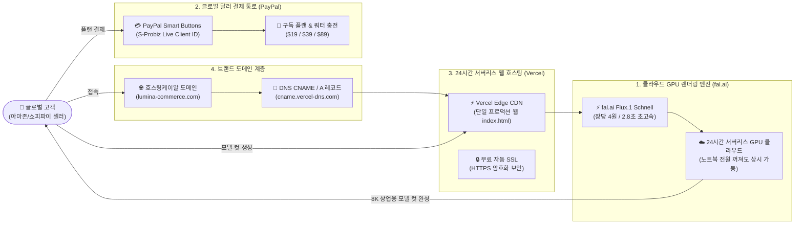

# 🌟 Lumina Commerce AI 24시간 무중단 실전 런칭 비주얼 가이드

> **S-Probiz (대표 Seyun, Connect AI Lab 대표 멤버십)**  
> **아마존·쿠팡 상세페이지 및 광고용 고전환(High-Converting) AI 모델 컷 SaaS**  
> **핵심 원칙**: 로컬 AI(내 노트북 GPU) 완전 배제 ➡️ **24시간 무중단 서버리스 클라우드 아키텍처**  

---

## 🏛️ 전체 시스템 아키텍처 (24/7 Cloud Architecture)



---

## 🗺️ 대표님이 내일 실행할 4단계 마스터 순서도

```
[STEP 1. 엔진 확보]       [STEP 2. 수익 통로]       [STEP 3. 클라우드 배포]     [STEP 4. 브랜드 완성]
   fal.ai 연동      ➡️      PayPal 검증     ➡️      Vercel 배포      ➡️    Hosting.kr 연결
 (GPU 연산 외주화)          (달러 수납 통로)          (24시간 무중단 엣지)         (독자 도메인/DNS)
```

---

### 1단계: fal.ai 클라우드 서버리스 GPU 연동
- **목표**: 내 컴퓨터 GPU(ComfyUI) 없이 장당 4원($0.003), 2.8초 만에 8K 상업용 모델 컷 렌더링
- **실행 절차**:
  1. [fal.ai](https://fal.ai) 가입 후 $10 무료 크레딧 수령
  2. [Keys 대시보드](https://fal.ai/dashboard/keys)에서 `Create Key` 클릭 ➡️ API Key 복사
  3. Lumina 웹 앱 우측 상단 `[fal.ai Key]` 모달에 붙여넣기 후 저장
  4. 1-Click 샘플(실크 드레스 등) 클릭 후 생성 테스트 ➡️ 2.8초 클라우드 렌더링 확인

---

### 2단계: PayPal Live 글로벌 결제 통로 검증
- **목표**: 전 세계 아마존/쇼피파이 셀러들의 달러 결제가 S-Probiz 법인 계좌로 직결
- **실행 절차**:
  1. [PayPal Developer](https://developer.paypal.com) 로그인 (S-Probiz 계정)
  2. Live Client ID 확인 (`BAAIPmk5qriDSaBAwhfhcDyAYSqaTniwslBBk_M5D7NUahWV-obdya0hI3FaHmquf4Gabh-TIYBZ79iAik` 기탑재)
  3. `[Pricing]` 탭에서 플랜 클릭 시 PayPal Smart Buttons 및 디지털 재화 환불 정책 동의 체크박스 확인
  4. 개발/테스트용 `[Staging/Test] 1-Sec Instant Approval` 버튼으로 500장 쿼터 충전 시뮬레이션

---

### 3단계: Vercel 24시간 365일 무중단 무료 엣지 배포
- **목표**: 내 노트북을 끄고 외출해도 전 세계 어디서나 0.1초 만에 사이트가 열리도록 배포
- **실행 절차**:
  1. GitHub에 비공개(Private) 저장소 `lumina-commerce-ai` 생성
  2. 터미널에서 코드 푸시:
     ```bash
     git add .
     git commit -m "feat: Launch Lumina Commerce AI v2.0 Production Serverless Studio"
     git branch -M main
     git remote add origin https://github.com/YOUR_GITHUB_ID/lumina-commerce-ai.git
     git push -u origin main
     ```
  3. [Vercel.com](https://vercel.com) 로그인 ➡️ `Add New...` ➡️ `Project` ➡️ 저장소 선택 후 `Deploy` 클릭
  4. 약 20초 만에 글로벌 CDN 배포 완료 (`https://lumina-commerce-ai.vercel.app`)

---

### 4단계: Hosting.kr 독자 도메인 및 DNS CNAME 연결
- **목표**: 독자 브랜드 도메인(예: lumina-commerce.com) 연결 및 Vercel 무료 SSL 자물쇠 마크 자동 활성화
- **실행 절차**:
  1. 호스팅케이알에서 영문 도메인 구매
  2. Vercel 대시보드 ➡️ 프로젝트 ➡️ `Settings` ➡️ `Domains`에 구매한 도메인 입력
  3. 호스팅케이알 `DNS 레코드 관리`에 아래 값 등록:

| 레코드 유형 (Type) | 호스트 / 이름 (Name) | 값 / 대상 (Value / Target) | 비고 |
| :---: | :---: | :---: | :---: |
| **CNAME (권장)** | `app` (또는 `studio`) | `cname.vercel-dns.com` | 서브도메인 접속 시 |
| **A** | `@` (또는 비워둠) | `76.76.21.21` | 루트 도메인 접속 시 |

---

## 💰 보수적 순마진 88% 검증표

| 플랜명 | 월 구독료 | 월 제공량 | 예상 fal.ai GPU 원가 | PayPal 결제 수수료 | 호스팅/환전 버퍼 (3%) | **월 예상 순수익** | **보수적 순마진율** |
| :--- | :---: | :---: | :---: | :---: | :---: | :---: | :---: |
| **Starter** | **$19.00** | 150장 | $0.45 (2.4%) | ~$1.15 (6.0%) | ~$0.57 | **$16.83** | **88.6%** 🏆 |
| **Pro (주력)** | **$39.00** | 500장 | $1.50 (3.8%) | ~$1.85 (4.7%) | ~$1.17 | **$34.48** | **88.4%** 🚀 |
| **Agency** | **$89.00** | 1,500장 | $4.50 (5.1%) | ~$3.60 (4.0%) | ~$2.67 | **$78.23** | **87.9%** 💎 |

---

## 👑 대표님(Seyun) 전용 'Owner Pass' 무제한 모드
- 웹 최하단(Footer) 우측의 `👑 Owner Pass (Seyun)` 버튼을 클릭하면 즉시 `👑 OWNER (∞)` 모드가 켜집니다.
- 횟수 제한이나 결제 없이 100% 무료로 무제한 렌더링 테스트가 가능합니다.
