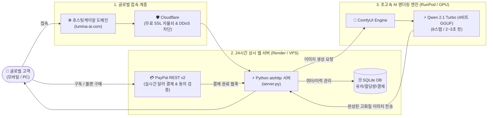
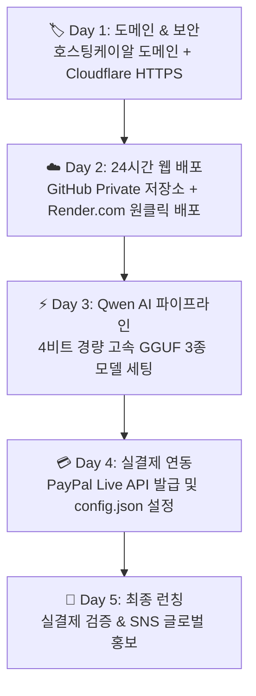
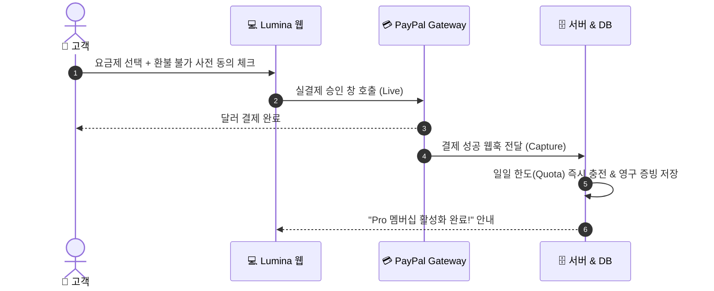

# 🌟 Lumina AI 24시간 무중단 클라우드 상용 배포 비주얼 가이드

> **컴퓨터를 꺼도 365일 24시간 전 세계 고객이 접속하여 결제하고, 고화질 AI 이미지를 초고속 생성하는 완전 자동화 비즈니스 구축서**

---

## 🏛️ 전체 시스템 아키텍처 (Cloud Workflow)



---

## 💎 핵심 마진 & 수익 시뮬레이션

```mermaid
xychart-beta
    title "플랜별 결제 금액 vs 사장님 순수익 (원 단위)"
    x-axis ["Starter ($15)", "Pro ($30)", "Pro 3개월 ($74)"]
    y-axis "금액 (원)" 0 --> 110000
    bar [20500, 41000, 101000]
    bar [20020, 39560, 96800]
```



* **Qwen 2.1 Turbo 4비트 GGUF**: 단 8스텝 렌더링으로 **장당 원가 약 1.2원 ($0.0009)**
* **압도적 마진율**: 고객 결제 금액의 **96% ~ 97.6%가 사장님의 순수익**으로 귀속됩니다.

| 플랜 구분 | 고객 결제 가격 | 일일 한도 | 월 평균 생성량 | 실제 GPU 원가 | 사장님 순마진 (마진율) |
| :--- | :---: | :---: | :---: | :---: | :---: |
| 🥉 **Starter** | **$15** (약 20,500원) | 40장 / 일 | 약 400장 | 약 480원 | **약 20,020원 (97.6%)** 🏆 |
| 🥈 **Pro** | **$30** (약 41,000원) | 150장 / 일 | 약 1,200장 | 약 1,440원 | **약 39,560원 (96.5%)** 🚀 |
| 🥇 **Pro 3개월권** | **$74** (약 101,000원) | 150장 / 일 | 약 3,500장 | 약 4,200원 | **약 96,800원 (95.8%)** 💎 |

---

## 🗺️ 5단계 상용화 로드맵 요약



---

## 📌 단계별 실전 실행 가이드

### 1단계: 도메인 구매 및 Cloudflare 무료 SSL 연동

```
[호스팅케이알] 도메인 구매 (연 1만~1.5만원)
      │
      ▼
[Cloudflare] 무료 가입 & 사이트 등록
      │
      ▼
[호스팅케이알] 네임서버를 Cloudflare 네임서버 2개로 변경
      │
      ▼
결과: 글로벌 무제한 트래픽 보호 + HTTPS 무료 자물쇠 자동 장착!
```

1. **[호스팅케이알(Hosting.kr)](https://www.hosting.kr/)**: `lumina-ai.com` 또는 `lumina-art.com` 검색 후 구매
2. **[Cloudflare](https://dash.cloudflare.com/)**: 사이트 추가 $\rightarrow$ `Free 플랜` 선택 $\rightarrow$ 제공되는 2개 네임서버 주소 복사
3. **호스팅케이알 [나의 도메인 관리]**: 네임서버 주소를 Cloudflare 주소로 교체 저장 (10~30분 후 자동 연결 완료)

---

### 2단계: GitHub 비공개 저장소 푸시 & Render.com 24시간 배포

> 내 컴퓨터를 꺼도 1년 365일 24시간 서비스가 중단 없이 가동되는 독립 웹 호스팅 세팅입니다.

#### ① GitHub Private 저장소 생성 및 푸시
```bash
git branch -M main
git remote add origin https://github.com/본인아이디/lumina-ai-saas.git
git push -u origin main
```

#### ② Render.com 원클릭 웹 서비스 배포 (월 $0 ~ $7)
* [Render.com](https://render.com/) 접속 $\rightarrow$ **New Web Service** 클릭
* 방금 생성한 `lumina-ai-saas` GitHub 저장소 선택
* **Environment**: `Python 3`
* **Start Command**: `python server.py`
* **Custom Domain**: Day 1에서 구입한 도메인(`lumina-ai.com`) 입력 $\rightarrow$ Cloudflare DNS CNAME 등록 끝!

---

### 3단계: Qwen-Image 2.1 Turbo (4비트 GGUF) 초고속 파이프라인

> 8스텝만으로 초고화질을 2~3초 만에 렌더링하는 공식 3개 모델 파일입니다.

| 역할 | 저장 폴더 경로 | 모델 파일명 | 다운로드 링크 |
| :--- | :--- | :--- | :--- |
| **Diffusion (Unet)** | `ComfyUI/models/diffusion_models/` | `qwen-image-2.1-turbo-Q4_K_M.gguf` | [HuggingFace 다운로드](https://huggingface.co/unsloth/Qwen-Image-2.1-Turbo-GGUF/resolve/main/qwen-image-2.1-turbo-Q4_K_M.gguf) |
| **Text Encoder** | `ComfyUI/models/text_encoders/` | `qwen3vl_8b_w4a8.safetensors` | [HuggingFace 다운로드](https://huggingface.co/Comfy-Org/Qwen-Image-2.1/resolve/main/text_encoders/qwen3vl_8b_w4a8.safetensors) |
| **VAE** | `ComfyUI/models/vae/` | `qwen_image_2.1_vae_bf16.safetensors` | [HuggingFace 다운로드](https://huggingface.co/Comfy-Org/Qwen-Image-2.1/resolve/main/vae/qwen_image_2.1_vae_bf16.safetensors) |

---

### 4단계: PayPal Live (실결제) 연동



1. [PayPal Developer 대시보드](https://developer.paypal.com/) 로그인
2. 상단 토글을 `Sandbox`에서 **`Live`**로 변경
3. `Apps & Credentials` $\rightarrow$ `Create App` $\rightarrow$ 앱 생성
4. `config.json`의 `paypal` 항목에 발급받은 실제 Live 키를 입력합니다:
```json
{
  "paypal": {
    "mode": "live",
    "client_id": "실제_발급받은_LIVE_CLIENT_ID",
    "client_secret": "실제_발급받은_LIVE_SECRET_KEY",
    "currency": "USD"
  }
}
```

---

### 5단계: 오픈 전 3분 최종 체크리스트

- [ ] **SSL 보안**: 도메인 접속 시 `https://` 자물쇠 아이콘이 정상 표시되는가?
- [ ] **동의 체크 검증**: 약관 미체크 시 결제 진행이 차단되는가?
- [ ] **1회 실결제 테스트**: 스마트폰에서 직접 $15 결제 시 내 페이팔 계좌로 입금되고 즉시 40회가 충전되는가?
- [ ] **이미지 생성 속도**: 프롬프트 입력 후 3초 내에 고화질 이미지가 완성되어 표시되는가?

---

## 🛠️ 핵심 소스코드 바로가기
* 프론트엔드 UI 페이지: `index.html`
* 반응형 다크 스타일: `style.css`
* 웹/API 백엔드 서버: `server.py`
* 환경설정 및 요금제 설정: `config.json`
* Qwen Turbo 공식 워크플로우: `workflow_qwen_turbo.json`

